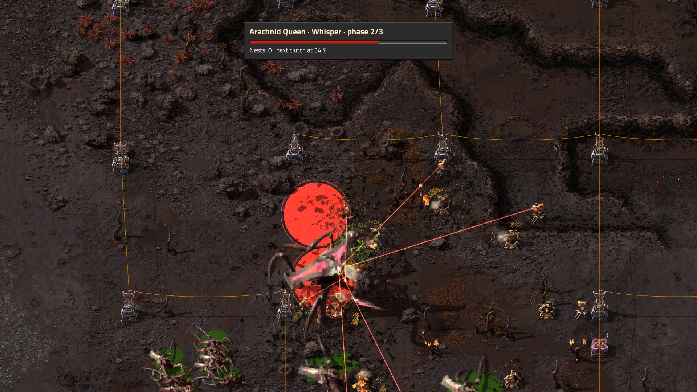
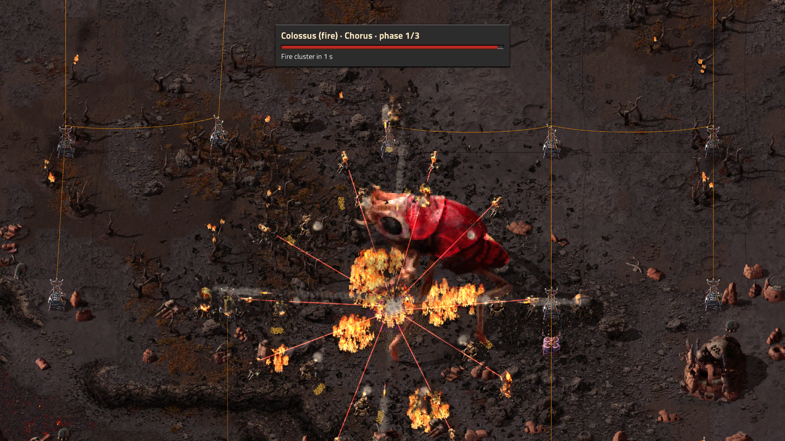
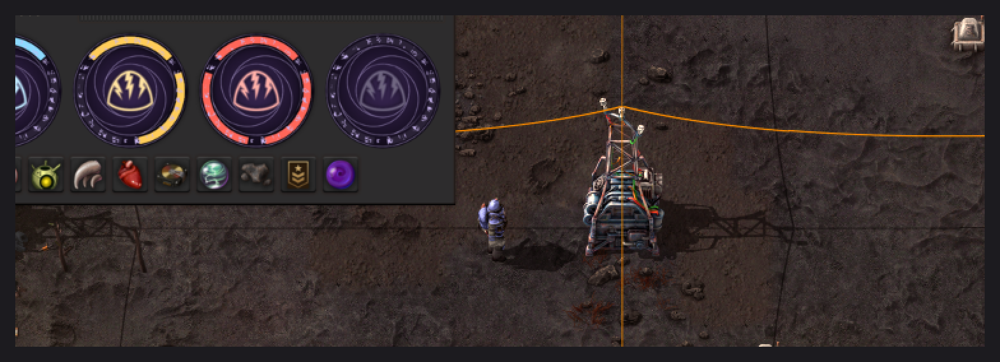
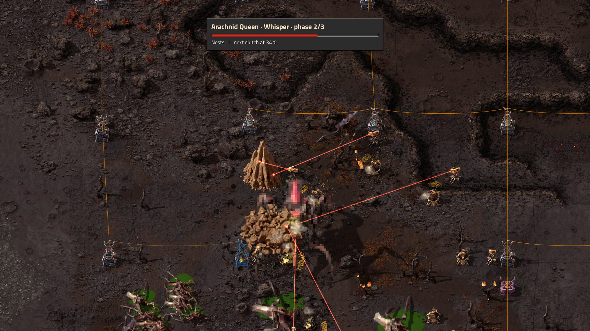
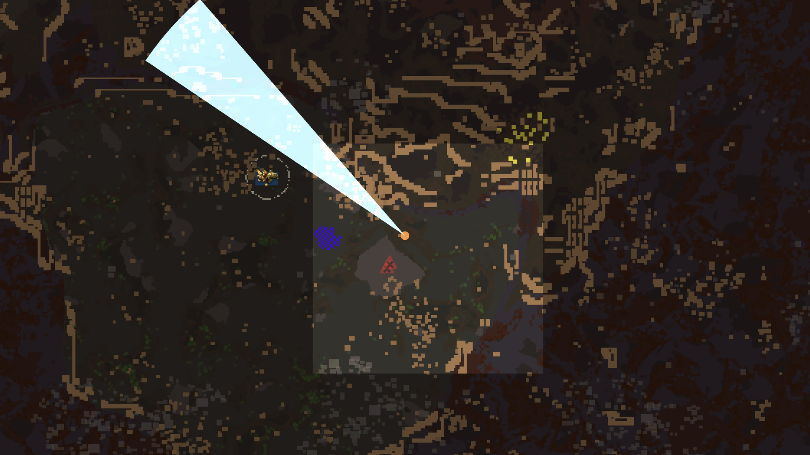
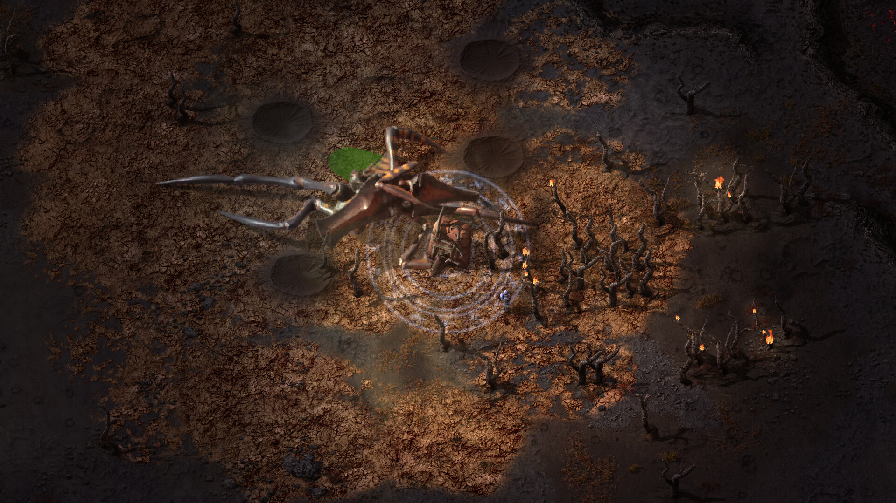
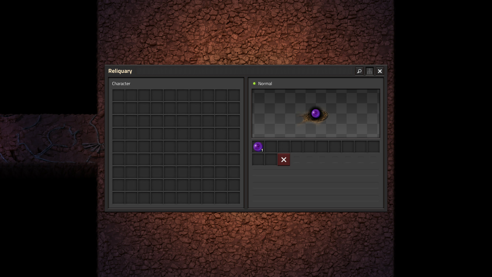

Nine bosses can be summoned on Nexus, the last planet of [Nexus Extended Promethium Endgame](https://mods.factorio.com/mod/Nexus). Light a summon beacon, defend it from the precursor waves, then fight the boss and claim its trophy. With the warp-drive gate enabled, place the warp key made from all nine trophies in the vault reliquary to research Silence and raise the relic.

## How it works

1. Craft a summon beacon for an unlocked boss and place it on Nexus.
2. Keep a player of your force on Nexus while the countdown runs. Two waves of precursors attack the beacon. Picking it up cancels the summon; if it is destroyed, it is lost.
3. If no defenses are within 600 tiles of the beacon for 60 seconds, the boss leaves and the beacon is lost. Otherwise, defeat the boss to claim its trophy. Defeat all three bosses in a stage to open the next one. Only one trial runs at a time.

## The nine bosses

After a boss log is found, its Codex page shows any weak damage types computed from its prototype resistances. The Colossus page lists the types for each variant.

| Stage | Boss | Mechanic | Answer |
| --- | --- | --- | --- |
| Whisper | Arachnid Queen | At two-thirds and one-third health, she lays two nests. Each sends warriors every 20 seconds until destroyed. | Fire, Laser and Electric. |
| Whisper | Watcher | Six electric drones escort it and return in waves. Every 12 seconds, if any drone lives, it marks a player building within 60 tiles and fires four rockets after a four-second warning. | Laser and Electric. |
| Whisper | Rogue Spidertron | It chooses among the 20 nearest power poles within 200 tiles, targeting the one with the most player buildings in its EMP radius. At 25 tiles it marks a 12-tile radius for three seconds, then disables buildings there for 15 seconds. | Poison. |
| Chorus | Twin Maws | While both maws live, each heals 0.3 % of its maximum health per second. If one dies while the other lives, it rises with half health after 20 seconds. | Fire. |
| Chorus | Colossus | One of six variants arrives, each with a different attack. The armoured variant absorbs damage for 10 seconds every 40 seconds; damage of its weak types breaks the shell after it absorbs 5 % of its maximum health. | The beacon names the variant; weak types are Physical (fire cluster and fire spray), Explosion (electric shock), Laser and Electric (armour shield), Acid and Poison (brood), or Fire (acid spray). |
| Chorus | Plague Hulk | Ten infected turrets guard it. Every 120 seconds it sends up to seven sortie units; when the squad first comes within 30 tiles of player turrets, a three-second warning marks a 15-tile circle where turrets stop for up to 15 seconds. | Impact, Acid, Poison, Explosion, Laser and Electric. |
| Convergence | Storm Guardian | After 60 seconds without a Nexus-Threat storm, it calls its own 40-second storm / 40-second calm cycle. During storms it heals up to 0.5 % of its health per second and calls lightning around itself. | Impact and Explosion. |
| Convergence | Devourer | It dives at half health, or at 66 % and 33 % in a lair, and resurfaces eight seconds later beyond the beacon. | Acid. |
| Convergence | Last Commander | A four-second circle marks where six soldiers land every 45 seconds. Below 66 % health, it marks a nearby building for four seconds before firing four rockets every 12 seconds; below 33 %, soldiers land beyond the beacon. Its atomic rocket targets the nearest turret within 60 tiles every 90 seconds, or the beacon if no turret is in range; a lair pylon can disable it. | No weak damage types; the Codex shows none. |

## Between the fights

- **Expedition logs.** Wrecks contain boss logs. Finding a log opens its mechanic, weak and resistant damage types, and answer in the Codex. The signal detector points to the nearest unfound wreck; each victory marks another wreck on the map.

  

  

  

- **Lairs and guards.** Two direction finders set to the same boss narrow their bearings until the crossing marks its lair. On the first approach to an unfound wreck or found lair, precursors are alerted when a player comes within 40 tiles; a warning circle appears and the group emerges three seconds later. Each point triggers once. A lair fight increases the boss's main mechanic frequency and gives an extra trophy and loot.
- **Pylons.** An uncommon-or-better trophy of the lair's boss repairs its pylon. The pylon weakens that boss's main mechanic by 25 %, 50 %, 75 % or 100 %, according to trophy quality. When it weakens a Last Commander lair fight at any quality, the atomic rocket is disabled.

  

- **Vault.** The vault becomes available after all nine bosses are defeated. Exploration and fights reveal the four glyphs for its code. With the warp-drive gate enabled, place the warp key made from the nine trophies in the reliquary; it is consumed to research Silence, and the relic rises in the vault. The relic gives research productivity +10 %.

  

- **Hallucinations.** At night on Nexus, a player with no force buildings within 64 tiles may see a phantom, receive a whisper or false alert, or see darkened screen edges. The average interval is 10 minutes in Whisper and 5 minutes in Chorus and Convergence, with ±50 % variation. Rare mode halves the frequency; the player setting can also turn hallucinations off. Clock-Interlude plays for a phantom or false alarm.

## FAQ

### Why is Big Monsters required?

It supplies the prototypes copied for the Watcher, Rogue Spidertron, six Colossus variants and Last Commander. Nexus Bosses spawns and controls its own copies.

### What does Nexus Bosses disable in Big Monsters?

Big Monsters' random events are off by default. The map setting can enable them on other planets; Nexus is excluded either way. Big Monsters' attacks on rocket silos are disabled.

### When does the Last Commander's atomic rocket fire?

When Nexus Bosses' `nexus-bosses-commander-nuke` setting is enabled (on by default), the rocket targets the nearest turret within 60 tiles of the Commander every 90 seconds, or the beacon if no turret is in range. In a lair fight, any repaired pylon that weakens the Commander disables it, regardless of trophy quality.

## Settings

- Startup: boss health multiplier, beacon cost multiplier, whether trials gate the warp drive.
- Map: countdown length, Big Monsters random events on other planets, skip the glyph puzzle, Last Commander atomic rocket (on by default).
- Player: hallucinations (normal, rare, off).

Administrators can stop a stuck trial with `/nexus-bosses-abort`.

## Sound

Each boss has an arrival sound; two fight tracks alternate during a trial. Nexus and the vault use music from [TFMG: Music](https://mods.factorio.com/mod/TFMG-music), a required dependency. Clock-Interlude plays during phantom and false-alarm hallucinations.

Source and bug reports: [GreenTech-Solutions/nexus-bosses](https://github.com/GreenTech-Solutions/nexus-bosses). Asset sources are listed in [CREDITS.md](https://github.com/GreenTech-Solutions/nexus-bosses/blob/master/CREDITS.md).
