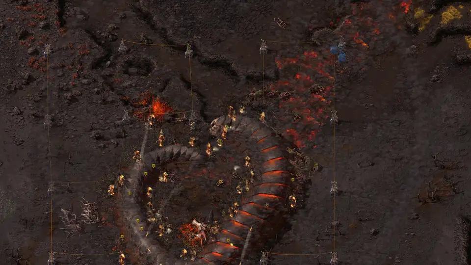
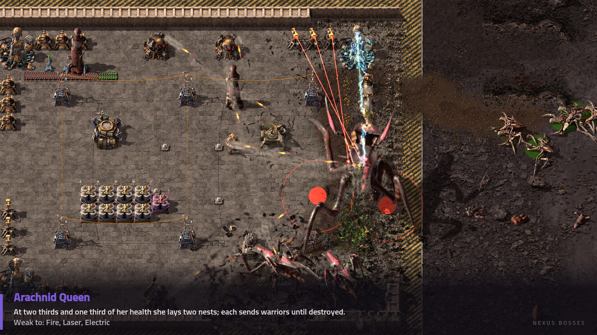
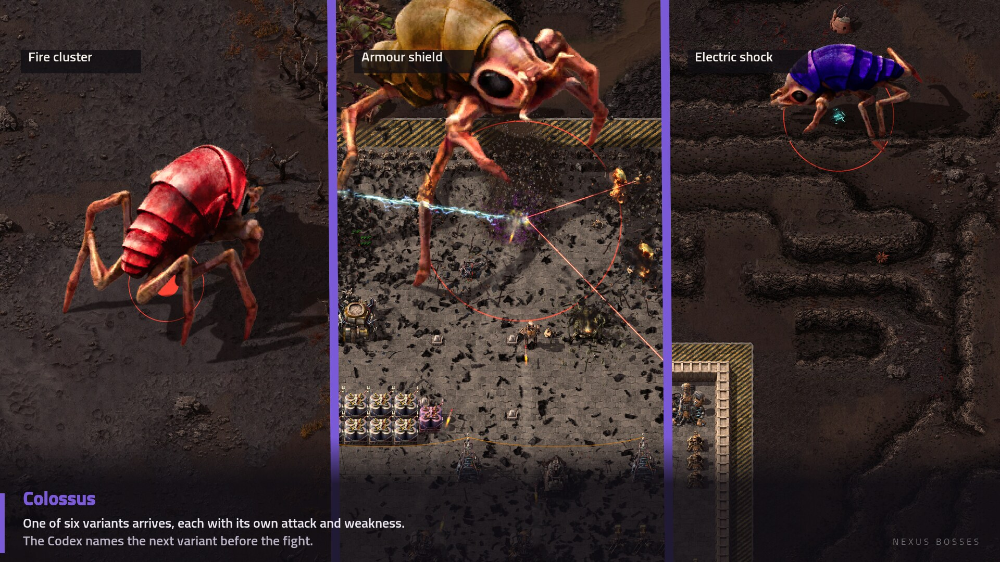
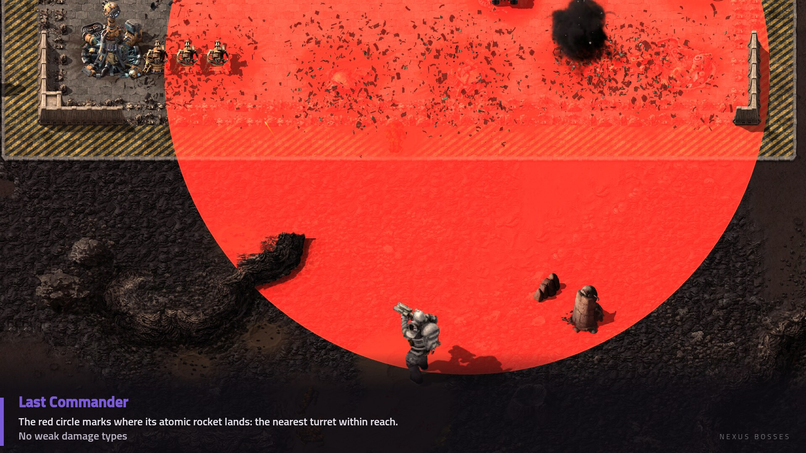
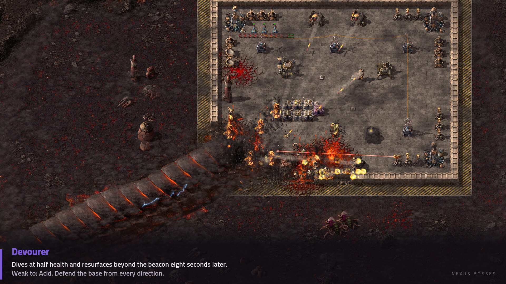
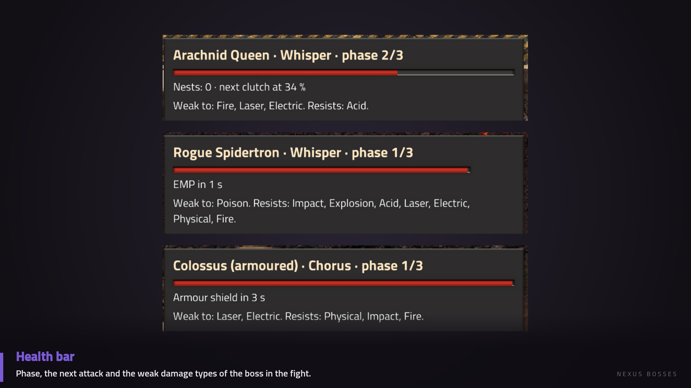
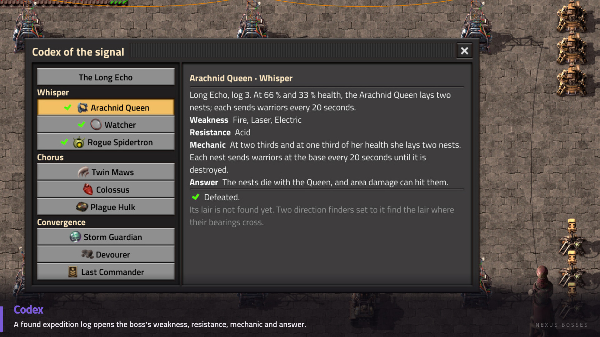
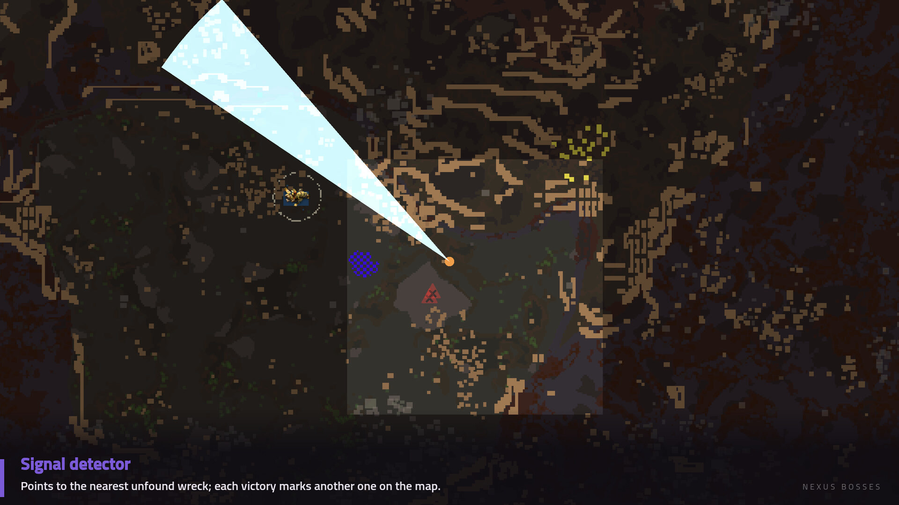
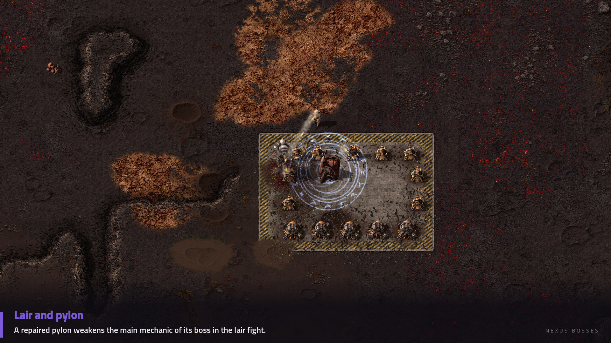
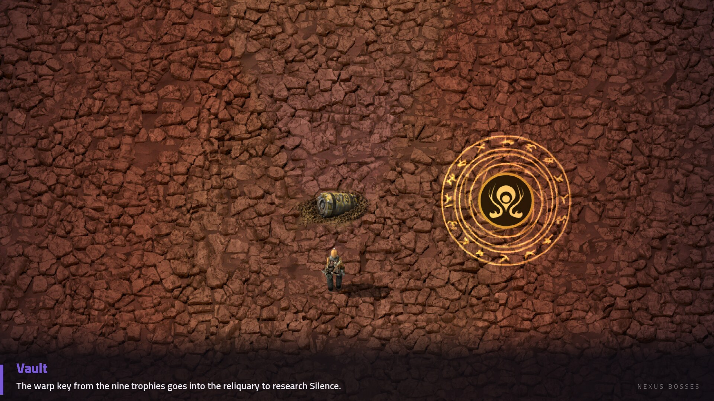

Nine bosses can be summoned on Nexus, the last planet of [Nexus Extended Promethium Endgame](https://mods.factorio.com/mod/Nexus). Each one has a mechanic that your defense has to answer, and the fight shows it on the ground before it hits.

## How it works

1. Craft a summon beacon for an unlocked boss and place it on Nexus.
2. Keep a player of your force on Nexus while the countdown runs. Two waves of precursors attack the beacon. Picking it up cancels the summon; if it is destroyed, it is lost.
3. If no defenses are within 600 tiles of the beacon for 60 seconds, the boss leaves and the beacon is lost. Otherwise, defeat the boss to claim its trophy. Defeat all three bosses in a stage to open the next one. Only one trial runs at a time.

## The nine bosses

The exact numbers are in the Codex once the boss log is found.

### Whisper

| Boss | Mechanic | Weak to |
| --- | --- | --- |
| Arachnid Queen | Lays two nests at two thirds and one third of her health; the nests send warriors until destroyed. | Fire, Laser, Electric |
| Watcher | While one of its drones lives, it marks a building and fires rockets at it. | Laser, Electric |
| Rogue Spidertron | Marks the power pole with the most buildings around it, then disables everything in the circle with an EMP. | Poison |

### Chorus

| Boss | Mechanic | Weak to |
| --- | --- | --- |
| Twin Maws | While both maws live they heal each other; a fallen maw rises again unless the second one dies quickly. | Fire |
| Colossus | One of six variants arrives, each with its own attack. | Depends on the variant |
| Plague Hulk | Spores follow its sortie squad and stop the turrets in a marked circle. | Impact, Acid, Poison, Explosion, Laser, Electric |

### Convergence

| Boss | Mechanic | Weak to |
| --- | --- | --- |
| Storm Guardian | Heals during a storm and calls lightning around itself; without a storm it calls its own. | Impact, Explosion |
| Devourer | Dives at half health and resurfaces beyond the beacon. | Acid |
| Last Commander | Drops soldiers at marked spots, marks buildings for rocket strikes and fires an atomic rocket at the nearest turret. | None |

## During the fight

The health bar shows the stage, the phase, the next attack with its countdown, and the weak and resistant damage types of the boss. The Colossus bar names the variant.

## Between the fights

- **Expedition logs.** Wrecks contain boss logs. Finding a log opens its mechanic, weak and resistant damage types, and answer in the Codex. The signal detector points to the nearest unfound wreck; each victory marks another wreck on the map.

  

  

- **Lairs and guards.** Two direction finders set to the same boss narrow their bearings until the crossing marks its lair. On the first approach to an unfound wreck or found lair, precursors are alerted when a player comes within 40 tiles; a warning circle appears and the group emerges three seconds later. Each point triggers once. A lair fight increases the boss's main mechanic frequency and gives an extra trophy and loot.
- **Pylons.** An uncommon-or-better trophy of the lair's boss repairs its pylon. The pylon weakens that boss's main mechanic by 25 %, 50 %, 75 % or 100 %, according to trophy quality. When it weakens a Last Commander lair fight at any quality, the atomic rocket is disabled.

  

- **Vault.** The vault becomes available after all nine bosses are defeated. Exploration and fights reveal the four glyphs for its code. With the warp-drive gate enabled, place the warp key made from the nine trophies in the reliquary; it is consumed to research Silence, and the relic rises in the vault. The relic gives research productivity +10 %.

  

- **Hallucinations.** At night on Nexus, far from your buildings, a player may see a phantom or get a false alert. The player setting makes them rare or turns them off.

## FAQ

### Why is Big Monsters required?

It supplies the prototypes copied for the Watcher, Rogue Spidertron, six Colossus variants and Last Commander. Nexus Bosses spawns and controls its own copies.

### What does Nexus Bosses disable in Big Monsters?

Big Monsters' random events are off by default. The map setting can enable them on other planets; Nexus is excluded either way. Big Monsters' attacks on rocket silos are disabled.

### When does the Last Commander's atomic rocket fire?

When Nexus Bosses' `nexus-bosses-commander-nuke` setting is enabled (on by default), the rocket targets the nearest turret within 60 tiles of the Commander every 90 seconds, or the beacon if no turret is in range. In a lair fight, any repaired pylon that weakens the Commander disables it, regardless of trophy quality.

## Settings

- Startup: boss health multiplier, beacon cost multiplier, whether trials gate the warp drive.
- Map: countdown length, Big Monsters random events on other planets, skip the glyph puzzle, Last Commander atomic rocket (on by default).
- Player: hallucinations (normal, rare, off).

Administrators can stop a stuck trial with `/nexus-bosses-abort`.

## Sound

Each boss has an arrival sound; five fight tracks play in turn during a trial, starting with a random one. Nexus and the vault use music from [TFMG: Music](https://mods.factorio.com/mod/TFMG-music), a required dependency. Clock-Interlude plays over the current music during phantom and false-alarm hallucinations.

Source and bug reports: [GreenTech-Solutions/nexus-bosses](https://github.com/GreenTech-Solutions/nexus-bosses). Asset sources are listed in [CREDITS.md](https://github.com/GreenTech-Solutions/nexus-bosses/blob/master/CREDITS.md).
